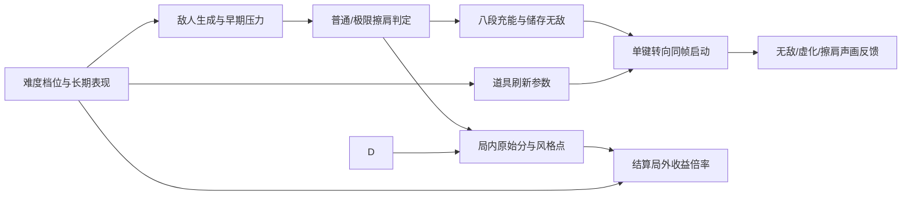

# v0.2.5 优化方案（设计记录）

状态：**方向已讨论确定，参数与美术表现待原型试玩**。记录日期：2026-10-30。本文是 v0.2.5 的优化方案与版本记录；不表示代码已实现或版本已发布。基线为当前 v0.2 网页游戏，实施前以代码和实机再次核对。

**后续反馈修订：**送球后的背景纹样成长已取消；八段充能短弧只在每次获得无敌充能后短暂显示累计进度，随后隐藏。具体实施状态以 [v0.2.5 规则记录](v0.2.5-rule-record.md) 为准。

## 1. 玩家反馈与真实需求

| 玩家说法 | 确认的体验问题 | 对玩家提出的解法的判断 | v0.2.5 方向 |
| --- | --- | --- | --- |
| 只能右转，被敌人夹住 | 早期可能遇到来不及判断或无路可走的夹击 | “开放随时左右转”不是本次需求；右转仍是核心约束 | 保留单键转向，允许偶发可预判的夹击，降低过早、连续、无解夹击 |
| 道具不够爽 | 道具接触频率低，无敌和虚化的效果尤其缺少力量感与行为辨识度 | 只增加粒子数量不能解决频率和可读性 | 整局提高道具密度；拾取、生效、结束均有清楚反馈；重做无敌撞击和虚化穿透演出 |
| 前期难，想加命 | 基本规则未掌握时，敌人压力已经到来 | “加命”只是候选手段，不作为本次定案 | 四档难度加长期动态扶持；教基础操作，进阶技巧留给玩家发现 |
| 送球不如普通擦肩，极限擦肩不值 | 普通擦肩和送球同为 +1，极限擦肩额外收益主要在结算体现 | 单纯提高所有分值会联动刷怪和解锁，不宜直接照做 | 区分送球、普通擦肩、极限擦肩的奖励；擦肩充能，送球维持得分，取消背景成长 |

## 2. v0.2 基线证据

- `src/core.mjs` 将首次奖励设在第 7 个刷新槽；`src/progression.mjs` 规定低分段后续奖励间隔为 14–18 槽，敌人刷新间隔随局内分数变化。
- `src/powerups.mjs`：无敌进入奖励池需 10 分且第 6 波，虚化需 18 分且第 10 波；两者各持续 5 秒且互相替换。提高奖励刷新率本身不能保证短局玩家见到这两种道具。
- `src/core.mjs`：普通与极限擦肩当前均给 1 局内分；极限额外给结算用风格点。所有走 `score()` 的得分都会调用 `resetSize()`，使角色缩小并提高后续成长和移动速度。送球也只给 1 局内分。
- `src/core.mjs`：普通敌人进入高度随机；特殊闪现敌人有独立预警。现有三段教程分别练习转向、送球、避敌，结束后进入正式局。
- `src/main.mjs`、`src/powerup-visuals.mjs`：擦肩、敌人碎裂、炸弹与无敌已有不同强度震动和效果；无敌、虚化已有浅色背景与角色光环，但玩家反馈实际撞击/穿透感仍不足。
- `finishRound()` 当前将 `score + lastStylePoints` 加入局外可用点数；尚无难度倍率。修改结算时必须把本局原始分、风格点和倍率后收益分开。

以上是代码事实和玩家主观反馈的并列记录。**尚无死亡录像或新玩家样本**证明夹击出现频率、教学完成率或道具实际拾取率；这些作为下文的测量项。

## 3. 已确定的玩法边界

| 系统 | 已确定规则 | 参数或细节待试玩 |
| --- | --- | --- |
| 操作与敌人 | 保留单键右转规则；允许夹击，减少早期、连续和无解夹击 | 危险预测窗口、重新抽取次数、各难度的允许范围 |
| 道具密度 | 整局道具更频繁；无敌与虚化的实际表现重点重做 | 首次槽位、后续间隔、两道具进入奖池的门槛与占比 |
| 冲击层级 | 全屏清除为最强标尺；普通擦肩、极限擦肩、无敌撞击使用不同强度的弱化版；虚化以穿透辨识为主 | 震动幅度/时长、停顿、音频、粒子数量与减弱动态模式 |
| 难度 | 菜鸟、入门、困难、噩梦四档；每档依据长期表现小幅动态扶持，噩梦浮动最窄 | 各档基线、适应窗口、调节上限、默认档与局外收益倍率 |
| 教学 | 明确教会转向、拾取送达、避敌；原地转圈和路线规划由玩家探索 | 正式局开场扶持程度、失败提示和重复教程入口 |
| 擦肩计分 | 普通擦肩取消直接 +1，保留消敌和充能；极限擦肩保留局内得分，并充更多能量 | 极限额外能量份额、原有连续擦肩风格奖励如何并存 |
| 充能与无敌 | 角色周围八段短弧；敌人碎裂后光团飞向角色，每次获得充能时短暂显示累计进度，随后隐藏；满格储存一次无敌；下一次空格/触屏点击**正常转向并在同一输入启动无敌**；无敌期间不再充能 | 每类擦肩点亮段数、储存与现有无敌道具的相互作用、持续时间 |
| 场景 | 取消送球后从目标圈向外生长的背景纹样；送球仍按现有规则得分 | 不再制作送达驱动的场景成长 |

**缩小机制边界待确认：**普通擦肩取消直接得分后，不应再因普通擦肩触发 `resetSize()`。本次讨论没有授权取消送球、极限擦肩或道具得分后的缩小；这些来源维持 v0.2 行为，除非后续另行确定。

## 4. 玩法方案与实现依赖

### 4.1 敌人生成和长期扶持

将难度档位作为可选择的**基线**，将长期表现调整作为该档位内缓慢变化的修正量。参考最近多局的送球次数、存活阶段、死亡原因与重复早死；不可只用总分，因为道具和极限擦肩会改变分数。调整在局与局之间生效，不在玩家正在躲避时突然改变速度、碰撞或转向。噩梦档也允许调整，但幅度最窄。

在生成候选敌人时，评估它与已有敌人在短预测窗口内对玩家可走路线的覆盖。若将导致过早、连续或无法作出有效选择的夹击，重新抽取进入位置或延迟该敌人；不要完全禁止双敌夹击。难度档位和扶持量可以调整接受阈值，但不改变碰撞真值。需要记录候选被拒原因、最终生成位置及死亡时是否有可执行路线，以便验证没有把刺激性一起消除。

### 4.2 奖励刷新与声画

保留“奖励占用刷新槽”的基本结构，但对首次出现、分段间隔和种类门槛做联合调参。不能只缩短 `bonusGapRange()`：无敌和虚化的双门槛仍可能让低分短局看不到它们。观察实际**拾取**而非仅生成次数。无敌道具与擦肩充满后的无敌应共享一套碰撞效果和持续状态显示。

冲击反馈以当前全屏清除为上限。普通擦肩用短促局部碎裂与轻震；极限擦肩在此基础上清楚提升声画层级；无敌撞击要让主动撞碎敌人的动作有重量，但连续撞击应聚合震动，避免每个敌人分别造成长震；虚化穿敌使用穿透涟漪、角色残像等与无敌明显不同的反馈。保留“动态效果：减弱”下的辨识性。

### 4.3 擦肩、充能、转向

普通擦肩的事件仍清除敌人并产生飞向角色的光团，但不进入 `score()`，也不显示 `+1`。极限擦肩保留局内得分；它与普通擦肩的能量差异必须在八段光弧上立即可见。八段是已定的表现规模；“普通 +1 段、极限 +2 段”可作**试玩候选**，尚非最终数值。

满格后将无敌作为一次待释放状态，而不是立刻消耗。下次有效转向输入同时转向、启动无敌；空格、鼠标和触屏应一致，无敌需在该输入之后的敌人碰撞判定前生效。短弧只在获得充能后短暂显示累计进度并淡出，满格待释放期间也不常驻；释放时给无敌启动反馈。无敌期间清除敌人和穿越行为不再增加能量，以避免自我循环。充能满格、拾取无敌道具、虚化状态的冲突处理应先以状态表列出，再实现。

### 4.4 教学与结算

教程只说明基础规则和当下目标，不展示原地转圈、最优路线或极限擦肩教程答案。正式局根据档位与长期扶持逐步施压；失败提示可指出撞墙/撞敌或未能返程，但不指示唯一解。送球后的背景纹样成长已取消。控制亮度、动效和布局，确保敌人、预警、短暂显示的充能弧、携带球及皮肤仍可分辨。

结算保留本局原始分用于成绩比较和局内阶段，另计算局外可用点数：`局外收益 = floor((原始分 + 适用的风格收益) × 所选档位倍率)` 为待验证的**公式候选**。倍率只作用于结算奖励；原始分不按倍率改写。界面应列出原始分、风格收益、档位倍率和最终获得点数。倍率数值与向下取整、皮肤收益先后顺序待确认。

## 5. 分阶段制作与验收

| 阶段 | 产物 | 验收方式 |
| --- | --- | --- |
| 0. 基线采样 | v0.2 短局录像与事件日志：敌人生成、死亡、送达、擦肩分级、道具生成与拾取 | 至少能按事件复盘“无解夹击”“看见但来不及”“操作失误”；没有样本时不宣称现有发生率 |
| 1. 规则原型 | 普通/极限擦肩分流、八段储能、同键转向激活、结算原始分与收益分离 | 单帧事件顺序、无敌期间不充能、不同输入设备一致；核对普通擦肩无 `score()`/缩小 |
| 2. 难度与密度 | 四档、长期扶持、生成候选筛选、道具刷新与门槛 | 固定随机种子复盘各档；统计早期无解夹击、送球成功、每分钟实际道具拾取及档位差异 |
| 3. 声画 | 光团与短暂显示的八段短弧、无敌撞击、虚化穿透、分级震动 | 横屏手机和桌面实机检查可读性、遮挡、帧率及“减弱动态效果”模式 |
| 4. 盲测与调参 | 新玩家和熟练玩家试玩记录、参数修订、定稿 | 玩家无需说明能理解满格后的下一次转向会激活无敌；能区分无敌/虚化和普通/极限擦肩；送球成为可感知的主目标 |

**建议记录的核心指标：**每局送达数、前若干局的首次送达率、死亡前可走路线数、连续夹击/无解夹击比例、各档存活时间分布、奖励生成与拾取率、普通/极限擦肩比例、充能完成与实际释放率、无敌期间消敌数。把 v0.2 基线与 v0.2.5 原型对照；指标目标需在取得基线后设定。

## 6. 未定事项与风险

| 未定项或风险 | 决策前需要的证据 |
| --- | --- |
| 道具太密可能挤占敌人槽，并通过道具得分提前解锁敌人 | 同时比较敌人实际密度、拾取率、分数曲线与存活时间；调整门槛和间隔时成组验证 |
| 四档中难度倍率可能引导玩家选择最优刷点档 | 比较单位时间局外收益与送达率，不只比较单局倍率；记录原始成绩保持可比性 |
| 长期扶持可能被故意早死触发，或让玩家感到难度暗中跳变 | 多局平滑、上下限和冷却；用连续试玩观察难度变化，避免单局大幅回调 |
| 八段充能短暂显示时可能遮住携带球、皮肤和敌人 | 角色大小、所有皮肤与移动状态截图；检查手机实际尺寸和淡出时机 |
| 满格储存与无敌道具、虚化互斥状态之间可能冲突 | 明确优先级、是否保留已储存无敌、同帧拾取/转向/碰撞顺序后再实现 |
| 普通擦肩失去分数和缩小后可能不再值得冒险 | 观察擦肩使用率、死亡率、充能完成率及送达率；必要时调能量而非自动恢复 +1 |
| 极限擦肩的视觉收益可能仍弱于风险 | 盲测中让玩家指出普通/极限差异，核对局内回报是否能被立即感知 |

本方案定案范围止于体验目标和规则边界。上述数值、视觉主题、状态冲突处理与验收目标须经原型和试玩确认后写入正式规则记录。
